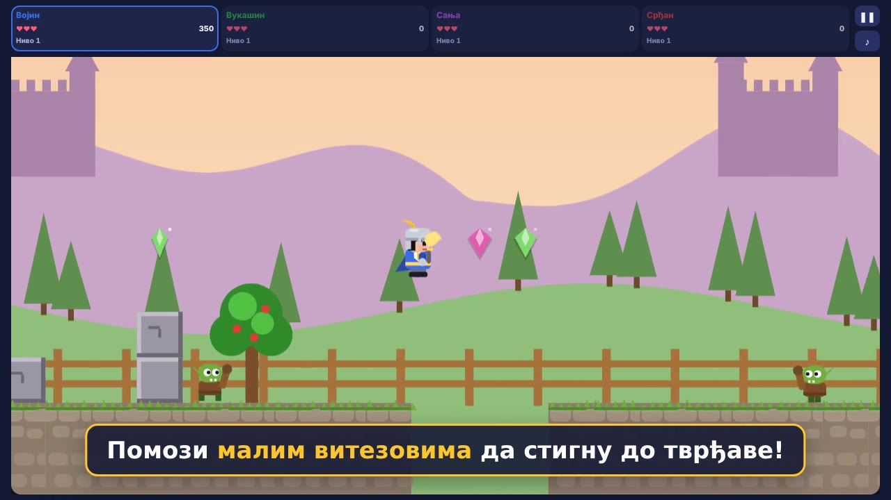

<p align="center">
  
</p>

<h1 align="center">Пут до Краљеве тврђаве</h1>

<p align="center">
  Platformska igrica za jednog ili više igrača (do 4). Mali vitezovi <b>Vojin</b>, <b>Vukašin</b>, <b>Sanja</b> i <b>Srđan</b> prolaze 10 nivoa,
  skupljaju drago kamenje, otvaraju sanduke, bore se mačem sa goblinima i stižu do Kraljeve tvrđave.
</p>

<p align="center">
  <a href="apk/put-do-tvrdjave.apk?raw=1"><b>📱 Preuzmi APK za Android</b></a>
  &nbsp;·&nbsp;
  <a href="https://srdjan89np.github.io/put-do-tvrdjave/"><b>🎮 Igraj u pregledaču</b></a>
</p>

<p align="center">
  <a href="docs/promo.mp4"></a><br>
  <sub>▶ <a href="docs/promo.mp4">Pogledaj promo klip</a> (30 s)</sub>
</p>

---

## Kako se igra

- **Jedan ili više igrača:** na početku dodirneš ko igra, od 1 do 4: Vojin (plavi), Vukašin (zeleni), Sanja (ljubičasta) i Srđan (crveni). Redom kojim ih biraš, tako igraju.
- Igra se jedan po jedan. Kad neko izgubi život, na redu je sledeći. Ko ostane bez života ispada, ostali nastavljaju.
- Svaki igrač ima **3 života**. Na sredini svakog nivoa je kontrolna tačka.
- Na kraju nivoa vitez ulazi u dvorac i svira pobednička melodija.
- **Najbolji rezultati:** igra pamti 10 najboljih rezultata na uređaju. Tabela se vidi na kraju igre i u glavnom meniju, a rekord piše na početnom ekranu.
- Posle 10. nivoa ide završna scena sa kraljem i vatrometom. Pobeđuje igrač sa najviše poena.

### Kontrole

| | Telefon | Računar |
|---|---|---|
| Kretanje | ◀ ▶ | ← → ili A D |
| Skok | СКОК | ↑, razmak, W ili Z |
| Mač / praćka | УДАРАЈ (sa praćkom ПУЦАЈ) | X, F ili Shift |
| Pauza | ❚❚ gore (vidi se samo u igri) | P ili Esc |

Na pauzi je i link **Изађи**, koji prekida igru i vraća na glavni meni. Na Android telefonu dugme **nazad** pauzira igru, a drugi pritisak izlazi iz aplikacije.

### Mač i sanduci

- Dugme **УДАРАЈ** zamahuje mačem i obara neprijatelje ispred viteza. Kad vitez pokupi praćku, isto dugme piše **ПУЦАЈ** i puca.
- Sanduci sa blagom se otvaraju kad ih vitez dodirne, stane na njih ili ih udari mačem. Iz njih iskoči drago kamenje.

### Pokloni

Pokloni se dobijaju redom, dok vitez ne izgubi život:

1. **Praćka:** gađa kamenčićima i obara sve neprijatelje, i ježa.
2. **Super praćka:** tri zlatne zvezde odjednom, koje prolaze kroz neprijatelje.
3. **Oklop** (u paketiću): jedan udarac ne oduzima život.
4. **Konj** (u paketiću): brže trčanje, viši skok, može da se skoči i na ježa. Kad vitez udari nešto, padne sa konja, ali ne gubi život.

Kad izgubi život, vitez gubi sve poklone.

### Nivoi

1. Зелена ливада
2. Кристална пећина
3. Изнад облака
4. Пешчане дине
5. Ледена планина (klizav led)
6. Ватрена тврђава
7. Ноћна шума
8. Дубока пећина
9. Олуја у облацима
10. Краљева тврђава

Neprijatelji su goblini, ježevi (na njih ne sme da se skoči) i mali zmajevi. Svi mogu da se obore mačem. Prepreke su provalije, lava, šiljci, kružne testere, opruge i pokretne platforme.

## Instalacija na Android

1. Na telefonu otvori link **Preuzmi APK** iznad. APK je u folderu [`apk/`](apk/), a svaka nova verzija je i u [Releases](https://github.com/srdjan89np/put-do-tvrdjave/releases).
2. Otvori preuzeti fajl `put-do-tvrdjave.apk`.
3. Ako telefon pita, dozvoli instaliranje aplikacija iz ovog izvora.
4. Igrica se zove **„Пут до тврђаве“**. Igra radi i bez interneta, samo se tada ne prikazuje reklamni baner.

Nova verzija se instalira preko stare, rezultati se ne čuvaju između igara.

## Google Play

Trenutna verzija je **2.5** (broj verzije 17, Google Mobile Ads SDK 25.5.0, androidx.activity 1.10.1): radi na Androidu 7.0 i novijim, cilja Android 16 (API 36), a dugme „nazad“ radi i na Androidu 16. Fontovi su u aplikaciji.

**Reklame (AdMob).** Na dnu ekrana je reklamni baner preko cele širine, a igra je iznad njega. Igru igraju i deca, pa su reklame podešene po pravilima Google Play-a za porodice: bez personalizacije, samo za sve uzraste (G), bez reklamnog ID-ja i bez Privacy Sandbox dozvola. Internet treba samo za baner.

- [`android/admob.properties`](android/admob.properties): ID aplikacije i baner jedinice u AdMob-u (tu su i Google-ovi test ID-jevi za probu).
- [`android/version.properties`](android/version.properties): broj verzije; povećaj ga pre svakog otpremanja na Play.

- [`docs/play/`](docs/play/): ikonica za prodavnicu (512×512), velika slika (1024×500) i tekstovi za stranicu u prodavnici.
- [Politika privatnosti](https://srdjan89np.github.io/put-do-tvrdjave/privatnost.html) (izvor: [`docs/privatnost.html`](docs/privatnost.html)): link za Google Play.
- `.aab` za Play pravi GitHub Actions (vidi ispod). Pre otpremanja ga treba potpisati ključem za otpremanje, koji se ne čuva u repozitorijumu.
- [`scripts/play/make_aab.py`](scripts/play/make_aab.py): stari način pravljenja `.aab` bez Android SDK-a (za verzije bez reklama).

## Kako je napravljena

Cela igrica je jedan fajl, [`index.html`](index.html): HTML, CSS i JavaScript bez spoljnih biblioteka. Crta se na `<canvas>`, a zvuk i muzika se prave u pregledaču (Web Audio). Melodije na kraju nivoa su klasične i slobodne za korišćenje: Betovenova „Oda radosti“, Mocartova „Mala noćna muzika“ i „Turski marš“.

```
index.html                  igrica
apk/put-do-tvrdjave.apk     gotov Android APK (sa reklamnim banerom)
icon.png                    ikonica
android/                    Android aplikacija (WebView koji otvara index.html + AdMob baner)
scripts/fetch-fonts.sh      preuzima fontove Rubik i Nunito (ćirilica) za rad bez interneta
scripts/make-icons.py       crta ikonicu u svim veličinama
scripts/promo/              pravi promo klip docs/promo.mp4 iz prave igre
.github/workflows/          automatsko pravljenje APK-a i objava na GitHub Pages
```

### Automatsko pravljenje

Na svaki `push` na granu `main` GitHub Actions:

- pravi novi **APK** i **AAB** i objavljuje APK u [Releases](https://github.com/srdjan89np/put-do-tvrdjave/releases) (`android.yml`);
- oba gotova fajla čuva i na grani [`builds`](https://github.com/srdjan89np/put-do-tvrdjave/tree/builds);
- objavljuje igricu na **GitHub Pages** (`pages.yml`).

### Lokalno pokretanje

Otvori `index.html` u pregledaču. Za fontove bez interneta prvo pokreni:

```bash
bash scripts/fetch-fonts.sh fonts
```

APK i AAB lokalno (potrebni su Android SDK i Java 17):

```bash
mkdir -p android/app/src/main/assets
cp index.html icon.png android/app/src/main/assets/
bash scripts/fetch-fonts.sh android/app/src/main/assets/fonts
sed -i '/fonts.googleapis.com\|fonts.gstatic.com/d' android/app/src/main/assets/index.html
cd android && gradle assembleRelease bundleRelease
```

### Podešavanja za testiranje

Na vrhu skripte u `index.html`:

- `START_LEVEL`: nivo od kog igra kreće (`0` je prvi nivo).
- `TEST_HORSE`: `true` znači da igrač kreće na konju, sa praćkom i oklopom.

### Potpis aplikacije

APK se potpisuje stalnim test ključem `android/app/debug.keystore`, da bi nove verzije mogle da se instaliraju preko starih. Za sopstveni ključ dodaj u **Settings → Secrets and variables → Actions** tajne `ANDROID_KEYSTORE_BASE64`, `ANDROID_KEYSTORE_PASSWORD`, `ANDROID_KEY_ALIAS` i `ANDROID_KEY_PASSWORD`. Posle promene ključa staru aplikaciju treba jednom obrisati sa telefona.
